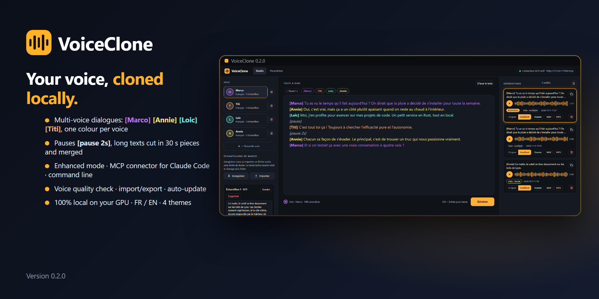

<p align="center"></p>

# VoiceClone

**[English](#english) · [Français](#français)**

[](https://www.paypal.com/donate/?hosted_button_id=CASVBK5K77DHC)

---

## Soutenir le projet / Support the project

**Français** : VoiceClone est gratuit. Je le développe seul, avec l'aide d'un assistant IA, et mon abonnement actuel m'impose des quotas qui limitent le rythme des évolutions. Si VoiceClone vous est utile, vous pouvez m'aider à prendre un abonnement plus poussé, pour avancer sans être freiné par ces limites. Le don est entièrement libre : il ne donne aucun avantage ni accès particulier, tout le monde a le même programme.

**English**: VoiceClone is free. I develop it on my own, with the help of an AI assistant, and the usage quota of my current plan limits how fast I can move. If VoiceClone is useful to you, you can help me move to a higher plan so I can keep developing without hitting those limits. Donations are entirely voluntary and give no perks or special access: everyone gets the same program.

[**Faire un don via PayPal / Donate via PayPal**](https://www.paypal.com/donate/?hosted_button_id=CASVBK5K77DHC)

---

## English

**VoiceClone** clones a voice from a short recording and generates speech with it, **locally** on your computer. It runs the **Qwen3-TTS** model through [qwentts.cpp](https://github.com/ServeurpersoCom/qwentts.cpp) on your graphics card (Vulkan: AMD, NVIDIA, Intel) and can be driven from its window or from **Claude Code** through an MCP connector. Nothing is sent to a server: voices, models and audio stay on your machine.

### Features

- **Voices from samples**: record with the microphone or import an audio file, with no length limit, and give its exact transcript for a faithful clone.
- **Text to speech** in a three-zone window: voices and samples, text to say, list of generations (waveform, play, copy the text).
- **Tags and dialogues**: buttons above the text insert `[pause]` (1 s, or `[pause 2.5s]`) and one `[VoiceName]` tag per voice at the cursor; the text after a voice tag is spoken with that voice, so a long multi-voice dialogue is one generation. Long texts are generated in pieces of 30 s at most and merged. The cloning model understands no emotion tags: to change the tone, add a voice recorded in that tone (e.g. "Zen cheerful") and use its tag.
- **One colour per voice**: the text box repaints each part of the text in the colour of the voice that will speak it (readable in all four themes); a generation spoken by several voices is labelled "multiple". A button in the Generations header deletes all generated audios (with confirmation).
- **Voice quality assistant**: under each sample, pitch, peak and noise measures and plain advice (too short, clipping, too quiet, background noise, missing or wrong transcript, samples from different people).
- **Export and import of voices**: Settings > Voices exports a voice as a folder (samples and transcripts) in the program's `Voix` subfolder and imports the voices found there.
- **One-click update**: the update card installs the new version (download, SHA-256 check against GitHub, replace, restart); your voices, audios and settings are never touched.
- **Transcript check**: a sample whose transcript does not fit its audio length (cut recording, suggested text left in place) is flagged and ignored for cloning, because it makes the voice drift.
- **Enhancement**: voice equalizer and normalized volume, switchable per generation (the original is always kept). WAV and MP3 export with a "Save as" dialog.
- **Claude Code (MCP)**: tools `speak` (with `enhanced`), `list_profiles`, `list_generations`; also available as a headless server with no window.
- **Graphics cards**: automatic detection, best choice proposed in Settings, automatic fallback to the processor. **Components** are checked in Settings and the missing ones can be installed from their official sources.
- **English and French** interface, four themes, **update check** against the GitHub releases.
- **Standalone**: no installation, Visual C++ runtimes included, optional portable mode.

### Inspiration

VoiceClone is inspired by [**Voicebox**](https://github.com/jamiepine/voicebox) by Jamie Pine, "the open-source AI voice studio" (MIT licence): voice cloning, audio generation and MCP control. Voicebox runs on PyTorch; VoiceClone keeps the idea of a page with voices and samples, text and generations, in a lighter version rewritten in Rust, with a ggml/Vulkan engine that uses AMD graphics cards on Windows (which Voicebox 0.5.0 did not). No Voicebox code is used.

### Download and first run

1. Get the latest archive from the [Releases](https://github.com/deherve/VoiceClone/releases) page: `VoiceClone-<version>-windows-x64.zip`. It contains the application with its window (`VoiceClone.exe`) and the version without a window (`voiceclone-server.exe`) in the same folder.
2. Unzip anywhere and run `VoiceClone.exe`. Nothing to install. Windows may warn about an unsigned program (SmartScreen): choose "More info", then "Run anyway".
3. **Settings > Models**: download the synthesis model (about 2 GB) and the audio codec (about 0.3 GB).
4. **Studio**: create a voice, add a sample and its transcript, type a text, **Generate**.

*Portable mode*: create an empty file named `portable` next to the program; your data then stay in a `data` folder instead of `%APPDATA%\VoiceClone`.
Requirements: Windows 10/11 64-bit, a graphics driver with Vulkan (otherwise the processor is used, about 4 times slower).

### Using it from Claude Code, an AI or a script

**Settings > "Connect an AI or a script"** gives everything ready to copy, with the real paths of your installation (they follow wherever the program is): the MCP declaration, the Claude Code command, how to start the server version, the command line, and complete instructions to paste into a skill or an AI. Start `VoiceClone.exe` or `voiceclone-server.exe` (not both: they share the port), then declare the connector in your project's `.mcp.json`:

```json
{ "mcpServers": { "voiceclone": { "type": "http", "url": "http://127.0.0.1:17494/mcp" } } }
```

Then ask for example: *"say this sentence with the voice Zen and write it to `public/voice/01.wav`, enhanced"* → `speak(text, profile="Zen", language="french", enhanced=true, output_path="…\01.wav")` (`enhanced=false` or omitted: standard quality).

**Quick command line** (no MCP needed): `voiceclone-server.exe speak "Hello everyone" --lang en --quality enhanced --voice Zen`

| Option | Meaning |
|---|---|
| `"text"` or `-t`, `--text` | text to say (`-` reads standard input) |
| `-l`, `--lang` | `fr`, `en`, `de`, `es`, `it`, `pt`, `ja`, `ko`, `zh`, `ru` (default: the voice's language) |
| `-q`, `--quality` | `standard` (default) or `enhanced` (voice equalizer + normalized volume) |
| `-v`, `--voice` | voice name (default: the first voice) |
| `-o`, `--out` | `.wav` file or folder (default: the **Audios** folder next to the program, where every generated audio is saved; an existing file is never replaced unless you name it) |

It prints the path of the file created. It uses the running server when there is one (fast), otherwise it loads the model for that single generation (about ten seconds more).

### Graphics cards and components

| Hardware | Status |
|---|---|
| AMD, Vulkan (RX 6700 XT) | **Tested**: faster than real time |
| NVIDIA, Vulkan | Same code as AMD, **not tested** on an NVIDIA card |
| NVIDIA, CUDA | **Not tested, not shipped** (no NVIDIA card or CUDA toolkit on the development machine) |
| Processor | Tested (about 4 times slower than the GPU) |

Settings > *Graphics card* lists the detected devices, proposes the best one (CUDA > Vulkan discrete > Vulkan integrated > processor) and falls back automatically if loading fails. Settings > *Components and tools* shows what is present and installs what is missing from official sources only: the Vulkan runtime from LunarG (SHA-256 and signature checked, Windows asks for permission) and the CUDA 12 libraries from NVIDIA (SHA-256 from NVIDIA's manifest). MP3 (LAME) is built in.

### Updates

VoiceClone checks the latest GitHub release (once a day at startup, or on demand; it can be turned off in Settings), shows a badge with the release notes and opens the release page. To update, download the new archive, close VoiceClone and replace its files: your data are kept. Versions go up by 0.0.1 and roll over after 9 (0.1.9 → 0.2.0); see [CHANGELOG.md](CHANGELOG.md).

### Build from source

Requirements: Rust, CMake, Visual Studio 2022 Build Tools, Vulkan SDK, Node.js (translation check), GitHub CLI (releases).

```bat
build-qwen.cmd                              :: engine with Vulkan → vendor\qwentts\build
cargo build --release                       :: the application; copies the engine DLLs next to VoiceClone.exe
cargo test --release -p voiceclone          :: tests
cargo test --release -p voiceclone -- --ignored   :: real model, GPU fallback and downloads from LunarG / NVIDIA
node scripts\check-i18n.mjs                 :: English and French dictionaries match
```

CUDA variant (untested): `build-qwen.cmd cuda` (needs the CUDA Toolkit 12.x), then `set VOICECLONE_QWEN_BUILD=build-cuda` and `cargo build --release`.
Publishing a version: `scripts\bump-version.ps1`, edit `CHANGELOG.md`, commit and push, then `scripts\release.ps1` (builds, checks that nothing is missing with `scripts\check-deps.ps1`, publishes both archives). Releases are built on this machine: there is no continuous integration.

| Environment variable | Role |
|---|---|
| `VOICECLONE_DATA` | data folder (default `%APPDATA%\VoiceClone`, or `data\` in portable mode) |
| `VOICECLONE_MODELS` | models folder (default `<data>\models`) |
| `VOICECLONE_PORT` | MCP connector port (default 17494) |
| `VOICECLONE_DEVICE` | force a device (`CUDA0`, `Vulkan0`, `CPU`), takes priority over Settings |
| `VOICECLONE_QWEN_BUILD` | engine variant linked at build time (`build` or `build-cuda`) |

### Third-party components and licence

- `vendor/qwentts`: a copy of commit `de2ad83` of [ServeurpersoCom/qwentts.cpp](https://github.com/ServeurpersoCom/qwentts.cpp) (MIT, see `vendor/qwentts/LICENSE` and `vendor/qwentts/ggml/LICENSE`), a C++ port of Qwen3-TTS (Alibaba, Qwen team). The copy does not include the example voice samples of the engine (`examples/freeman.*`) and the scripts that use them: no voice is distributed with VoiceClone.
- GGUF models downloaded from [Serveurperso/Qwen3-TTS-GGUF](https://huggingface.co/Serveurperso/Qwen3-TTS-GGUF) on Hugging Face (not included here; their licences apply).
- Interface: [Tauri](https://tauri.app). MP3: LAME (through `mp3lame-encoder`, LGPL).
- VoiceClone's own code has no licence file yet: until one is added, the default copyright applies.

Support the project: [Donate with PayPal](https://www.paypal.com/donate/?hosted_button_id=CASVBK5K77DHC). Thank you!

---

## Français

**VoiceClone** clone une voix à partir d'un court enregistrement et génère de la parole avec elle, **en local** sur votre ordinateur. Il exécute le modèle **Qwen3-TTS** via [qwentts.cpp](https://github.com/ServeurpersoCom/qwentts.cpp) sur votre carte graphique (Vulkan : AMD, NVIDIA, Intel) et se pilote depuis sa fenêtre ou depuis **Claude Code** grâce à un connecteur MCP. Rien n'est envoyé à un serveur : voix, modèles et audio restent sur votre machine.

### Fonctions

- **Voix à partir d'échantillons** : enregistrement au micro ou import d'un fichier audio, sans limite de durée, avec sa transcription exacte pour un clonage fidèle.
- **Synthèse vocale** dans une fenêtre à trois zones : voix et échantillons, texte à dire, liste des générations (forme d'onde, lecture, copie du texte).
- **Balises et dialogues** : des boutons au-dessus du texte insèrent au curseur `[pause]` (1 s, ou `[pause 2.5s]`) et une balise `[NomDeVoix]` par voix ; le texte qui suit une balise de voix est dit avec cette voix, un long dialogue à plusieurs voix est donc une seule génération. Les longs textes sont générés en morceaux de 30 s au plus puis fusionnés. Le modèle de clonage ne comprend aucune balise d'émotion : pour changer de ton, ajoutez une voix enregistrée sur ce ton (par ex. « Zen enjoué ») et utilisez sa balise.
- **Une couleur par voix** : la zone de texte repeint chaque partie du texte avec la couleur de la voix qui la dira (lisible dans les quatre thèmes) ; une génération dite par plusieurs voix est étiquetée « multiple ». Un bouton dans l'en-tête des Générations supprime tous les audios générés (avec confirmation).
- **Assistant de qualité des voix** : sous chaque échantillon, mesures de hauteur, de crête et de bruit et conseils clairs (trop court, saturation, niveau faible, bruit de fond, transcription absente ou fausse, échantillons de personnes différentes).
- **Export et import des voix** : Paramètres > Voix exporte une voix sous forme de dossier (échantillons et transcriptions) dans le sous-dossier `Voix` du programme et importe les voix qui s'y trouvent.
- **Mise à jour en un clic** : la carte de mise à jour installe la nouvelle version (téléchargement, vérification du SHA-256 auprès de GitHub, remplacement, relance) ; vos voix, vos audios et vos réglages ne sont jamais touchés.
- **Contrôle des transcriptions** : un échantillon dont la transcription ne correspond pas à la durée de son audio (enregistrement coupé, texte proposé laissé tel quel) est signalé et ignoré pour le clonage, car il fait dériver la voix.
- **Amélioration** : égaliseur de voix et volume normalisé, activable par génération (l'original est toujours conservé). Export WAV et MP3 avec boîte « Enregistrer sous ».
- **Claude Code (MCP)** : outils `speak` (avec `enhanced`), `list_profiles`, `list_generations` ; disponible aussi en version serveur sans fenêtre.
- **Cartes graphiques** : détection automatique, meilleur choix proposé dans Paramètres, repli automatique sur le processeur. Les **composants** sont contrôlés dans Paramètres et ceux qui manquent s'installent depuis leurs sources officielles.
- Interface en **anglais et français**, quatre thèmes, **détection des mises à jour** sur les releases GitHub.
- **Autonome** : aucune installation, runtimes Visual C++ inclus, mode portable en option.

### Inspiration

VoiceClone s'inspire de [**Voicebox**](https://github.com/jamiepine/voicebox) de Jamie Pine, « the open-source AI voice studio » (licence MIT) : clonage de voix, génération d'audio et pilotage par MCP. Voicebox tourne sur PyTorch ; VoiceClone reprend l'idée d'une page voix + échantillons, texte et générations, en version allégée réécrite en Rust, avec un moteur ggml/Vulkan qui utilise les cartes graphiques AMD sous Windows (que Voicebox 0.5.0 n'exploitait pas). Aucun code de Voicebox n'est repris.

### Téléchargement et premier lancement

1. Récupérez la dernière archive sur la page [Releases](https://github.com/deherve/VoiceClone/releases) : `VoiceClone-<version>-windows-x64.zip`. Elle contient l'application avec sa fenêtre (`VoiceClone.exe`) et la version sans fenêtre (`voiceclone-server.exe`) dans le même dossier.
2. Décompressez n'importe où et lancez `VoiceClone.exe`. Rien à installer. Windows peut avertir qu'un programme n'est pas signé (SmartScreen) : « Informations complémentaires », puis « Exécuter quand même ».
3. **Paramètres > Modèles** : téléchargez le modèle de synthèse (environ 2 Go) et le codec audio (environ 0,3 Go).
4. **Studio** : créez une voix, ajoutez un échantillon et sa transcription, saisissez un texte, **Générer**.

*Mode portable* : créez un fichier vide nommé `portable` à côté du programme ; vos données restent alors dans un dossier `data` au lieu de `%APPDATA%\VoiceClone`.
Prérequis : Windows 10/11 64 bits, un pilote graphique avec Vulkan (sinon le processeur est utilisé, environ 4 fois plus lent).

### Utilisation depuis Claude Code, une IA ou un script

**Paramètres > « Connecter une IA ou un script »** donne tout ce qu'il faut à copier, avec les chemins réels de votre installation (ils suivent l'endroit où se trouve le programme) : la déclaration MCP, la commande de Claude Code, le lancement de la version serveur, la ligne de commande et des instructions complètes à coller dans un skill ou une IA. Lancez `VoiceClone.exe` ou `voiceclone-server.exe` (pas les deux : ils partagent le port), puis déclarez le connecteur dans le `.mcp.json` de votre projet :

```json
{ "mcpServers": { "voiceclone": { "type": "http", "url": "http://127.0.0.1:17494/mcp" } } }
```

Demandez ensuite par exemple : *« dis cette phrase avec la voix Zen et écris-la dans `public/voix/01.wav`, en version améliorée »* → `speak(text, profile="Zen", language="french", enhanced=true, output_path="…\01.wav")` (`enhanced=false` ou absent : qualité standard).

**Ligne de commande rapide** (sans MCP) : `voiceclone-server.exe speak "Bonjour à tous" --lang fr --quality ameliore --voice Zen`

| Option | Rôle |
|---|---|
| `"texte"` ou `-t`, `--text` | texte à dire (`-` lit l'entrée standard) |
| `-l`, `--lang` | `fr`, `en`, `de`, `es`, `it`, `pt`, `ja`, `ko`, `zh`, `ru` (défaut : langue de la voix) |
| `-q`, `--quality` | `standard` (défaut) ou `ameliore` / `enhanced` (égaliseur de voix + volume normalisé) |
| `-v`, `--voice` | nom de la voix (défaut : la première voix) |
| `-o`, `--out` | fichier `.wav` ou dossier (défaut : le dossier **Audios** à côté du programme, où tous les audios générés sont enregistrés ; un fichier existant n'est jamais remplacé sauf si vous le nommez) |

Affiche le chemin du fichier créé. Utilise le serveur s'il tourne déjà (rapide), sinon charge le modèle pour cette seule génération (une dizaine de secondes de plus).

### Cartes graphiques et composants

| Matériel | Statut |
|---|---|
| AMD, Vulkan (RX 6700 XT) | **Testé** : plus rapide que le temps réel |
| NVIDIA, Vulkan | Même code que l'AMD, **non testé** sur une carte NVIDIA |
| NVIDIA, CUDA | **Non testé, non fourni** (ni carte NVIDIA ni CUDA Toolkit sur la machine de développement) |
| Processeur | Testé (environ 4 fois plus lent que le GPU) |

Paramètres > *Carte graphique* liste les périphériques détectés, propose le meilleur (CUDA > Vulkan dédié > Vulkan intégré > processeur) et se replie automatiquement si le chargement échoue. Paramètres > *Composants et outils* montre ce qui est présent et installe ce qui manque depuis les seules sources officielles : le runtime Vulkan de LunarG (SHA-256 et signature vérifiés, Windows demande l'autorisation) et les bibliothèques CUDA 12 de NVIDIA (SHA-256 du manifeste NVIDIA). Le MP3 (LAME) est intégré.

### Mises à jour

VoiceClone consulte la dernière release GitHub (une fois par jour au démarrage, ou à la demande ; désactivable dans Paramètres), affiche un badge avec les notes de version et ouvre la page de la release. Pour mettre à jour, téléchargez la nouvelle archive, fermez VoiceClone et remplacez ses fichiers : vos données sont conservées. Les versions avancent de 0.0.1 et passent à la dizaine suivante après 9 (0.1.9 → 0.2.0) ; voir [CHANGELOG.md](CHANGELOG.md).

### Compiler depuis les sources

Prérequis : Rust, CMake, Visual Studio 2022 Build Tools, Vulkan SDK, Node.js (contrôle des traductions), GitHub CLI (releases).

```bat
build-qwen.cmd                              :: moteur en Vulkan → vendor\qwentts\build
cargo build --release                       :: l'application ; copie les DLL du moteur à côté de VoiceClone.exe
cargo test --release -p voiceclone          :: tests
cargo test --release -p voiceclone -- --ignored   :: vrai modèle, repli du GPU et téléchargements LunarG / NVIDIA
node scripts\check-i18n.mjs                 :: les dictionnaires anglais et français concordent
```

Variante CUDA (non testée) : `build-qwen.cmd cuda` (CUDA Toolkit 12.x requis), puis `set VOICECLONE_QWEN_BUILD=build-cuda` et `cargo build --release`.
Publier une version : `scripts\bump-version.ps1`, compléter `CHANGELOG.md`, commit et push, puis `scripts\release.ps1` (compile, vérifie que rien ne manque avec `scripts\check-deps.ps1`, publie les deux archives). Les releases sont construites sur cette machine : il n'y a pas d'intégration continue.

| Variable d'environnement | Rôle |
|---|---|
| `VOICECLONE_DATA` | dossier de données (défaut `%APPDATA%\VoiceClone`, ou `data\` en mode portable) |
| `VOICECLONE_MODELS` | dossier des modèles (défaut `<données>\models`) |
| `VOICECLONE_PORT` | port du connecteur MCP (défaut 17494) |
| `VOICECLONE_DEVICE` | force un périphérique (`CUDA0`, `Vulkan0`, `CPU`), prioritaire sur Paramètres |
| `VOICECLONE_QWEN_BUILD` | variante du moteur liée à la compilation (`build` ou `build-cuda`) |

### Composants tiers et licence

- `vendor/qwentts` : copie du commit `de2ad83` de [ServeurpersoCom/qwentts.cpp](https://github.com/ServeurpersoCom/qwentts.cpp) (MIT, voir `vendor/qwentts/LICENSE` et `vendor/qwentts/ggml/LICENSE`), portage C++ de Qwen3-TTS (Alibaba, Qwen team). La copie ne contient pas les échantillons de voix d'exemple du moteur (`examples/freeman.*`) ni les scripts qui les utilisent : aucune voix n'est distribuée avec VoiceClone.
- Modèles GGUF téléchargés depuis [Serveurperso/Qwen3-TTS-GGUF](https://huggingface.co/Serveurperso/Qwen3-TTS-GGUF) sur Hugging Face (non inclus ici ; leurs licences s'appliquent).
- Interface : [Tauri](https://tauri.app). MP3 : LAME (via `mp3lame-encoder`, LGPL).
- Le code propre de VoiceClone n'a pas encore de fichier de licence : tant qu'il n'y en a pas, le droit d'auteur par défaut s'applique.

Soutenir le projet : [Faire un don avec PayPal](https://www.paypal.com/donate/?hosted_button_id=CASVBK5K77DHC). Merci !
